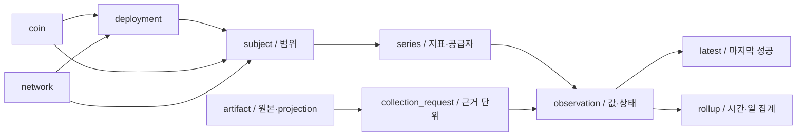

# PostgreSQL 시장 자료 저장 설계

상태: **설계 초안**, 2026-10-22. 사용자가 Supabase/PostgreSQL과 향후 다수 스테이블코인·네트워크 확장을 전제로 설계를 요청했다. [ADR0039](../adr/0039-postgresql-market-storage-design.md)의 설계 범위이며, 현재 실행 경계는 기존 ADR을 따른다. 실제 DB·Supabase 프로젝트 생성/접속·자동 수집·원본 이전·배포는 하지 않는다.

## 목표와 규모의 기준

현재3코인/4네트워크/8발행 자산과30개 저장 관측에 맞춘 고정 컬럼/배열이나 코인별 테이블을 만들지 않는다. 실제 등록한 코인·발행 자산·공급자·지표 조합을 시계열로 정의한다. 모든 코인이 모든 네트워크에 존재한다고 가정하지 않는다. 네트워크 등록도 해당 Adapter 지원이나 식별자 인증이 아니다.

핵심은 `coin → deployment ← network`와 `subject → series → observation`이다. 같은 coin/network에 여러 deployment가 공존하며 네이티브·브리지·다른 컨트랙트를 같은 자산으로 합치지 않는다. 기존 registry의 coin/network당1개 제한은 그대로 두고, 미래 DB 모델에서만 제한을 제거한다. registry/API v2 전환 전에는 복수 deployment를 기존 화면에 억지로 투영하지 않는다.

## 테이블과 관계

| 테이블 | 역할 | 고빈도 반복에서 제외하는 값 |
| --- | --- | --- |
| `coin`, `network`, `deployment` | 내부 정수 ID와 변경하지 않는 외부 code·체인 identity·발행 자산 identity | 심볼·이름·주소·issuer/currency |
| `subject` | COIN / COIN_NETWORK / DEPLOYMENT / NETWORK 비교 범위 | coin/network/deployment 조합 |
| `provider`, `provider_identifier` | 공급자와 namespace별 외부 식별자 | pricingId·chain key; 공급자 변경 시 내부 ID 유지 |
| `metric_definition` | 버전별 지표 의미·단위·집계 기간·정의 확인 상태 | 반복 단위·기간·설명 |
| `series` | subject+지표 버전+공급자+조회 경로+필드의 독립 시계열 | endpoint·selector suffix·scope |
| `request_definition`, `request_series`, `request_network` | 버전별 typed 대상·고정 public 요청 shape와 당시 기대한 시계열/네트워크 목록 | 매번 동일한 기대 필드 목록 |
| `artifact` | 보존한 파일/비공개 객체의 hash·길이·종류·상대 저장 key | 원본 JSON과 hash 문자열 반복 |
| `collection_run`, `collection_request` | 실행·개별 요청·결과·관측시각·artifact·확정 원장 | 같은 응답에서 얻은 지표들의 공통 근거 |
| `observation` | 시계열 ID·시각·요청 참조·상태·정확한 값·공급자 시각 | 원문·주소·URL·큰 JSON 없음 |
| `network_observation` | 네트워크 active/정수 tip과 해당 요청·시각 | 네트워크 상태를 토큰 수량으로 변환하지 않음 |
| `series_latest` | 마지막 성공 관측을 가리키는 작은 파생 캐시 | 전체 이력 순회 없이 현재값 조회 |
| `legacy_observation` | 기존 id/groupId/selector/deployment 연결 | 과거64자리 ID를 신규 모든 행에 복제하지 않음 |
| `series_rollup` | 시간/일별 첫값·최고·최저·끝값·표본 수와 lineage manifest | 장기 차트의 대량 원시 행 전송 |

원본 SQL은 [검토용 DDL](postgresql-market-schema.sql)이다. 앱이나 migration runner에 연결하지 않는다. `atlas_market_design`이라는 새 전용 schema만 만들며 `IF NOT EXISTS`로 기존 다른 설계를 묵인하지 않는다. PostgreSQL17+의 core 기능만 사용하고 TimescaleDB·pg_cron 같은 확장은 요구하지 않는다. Supabase 실제 엔진 버전·권한·용량은 연결 단계에서 다시 확인한다.

## 지표를 섞지 않는 규칙

| 현재 지표 | DB subject | 의미/이전 규칙 |
| --- | --- | --- |
| `PRICE`, `CIRCULATING`, `COIN_TOTAL` | COIN | 코인 전체 가격·유통량·현재 총공급량을 별도 시계열로 저장 |
| `CHAIN_TOTAL` | COIN_NETWORK | 현재 holders의 체인별 공급자 집계. 계약별 값이라고 인증하지 않음 |
| 실제 특정 계약/mint의 공급량 | DEPLOYMENT | 향후 독립 지표 정의·별도 읽기 승인/구현이 있어야 등록 |
| `OBLIGATIONS` | DEPLOYMENT | issuer/currency가 고정된 XRPL의 제한된 별도 지표; 유통량/총공급량으로 대체 불가 |
| `REPORTED_VOLUME` | COIN | unit UNKNOWN·period NULL·UNCONFIRMED를 유지하고 순위·합계에서 제외 |
| active/tip | 별도 `network_observation` | boolean과 정수 원문 의미 유지; 토큰 지표와 합산하지 않음 |

과거 `CHAIN_TOTAL`은 registry 제약 때문에 deployment에 연결돼 있었다. DB import에서는 COIN_NETWORK에 매핑하되 **기존 deployment 연결은 legacy bridge와 원본 파일에 보존**한다. 의미를 개선한 DB 시계열과 기존 ID/JSON을 구별하며 과거 report를 재작성하지 않는다. 복수 deployment가 생겨도 이 값을 각 계약에 복제하지 않는다.

가격의 기간별 거래량과 온체인 전송량, 공급량 snapshot, 원장별 obligations를 같은 metric code로 등록하지 않는다. 정의·단위·집계 기간이 바뀌면 새 metric version/series를 만든다. 공급자 전환도 다른 시계열이며 자동 연결/fallback은 없다. endpoint의 wrapper 배열 index는 시계열 식별자가 아니지만 개별 근거 단위의 위치 식별자로 보존한다. `selector_prefix + selector_suffix`로 원래 추출 위치를 복원한다.

## 정확도와 관측 상태

수량은 unconstrained `numeric`과 CHECK로 현재 허용 범위(정수 최대78자리의 양수/0, 소수 최대36자리)를 검증한다. 고정 `numeric(p,s)`는 입력을 반올림한 뒤 검사할 수 있으므로 사용하지 않는다. NaN/Infinity·음수·과도한 자리수는 거부한다. 토큰 최소단위와 표시 단위는 지표 정의에서 구별한다. 향후 signed 지표는 별도 설계가 필요하다.

DB driver와 API는 `numeric`, `bigint`를 십진 문자열로 전달한다. 비교·집계는 SQL numeric/애플리케이션 bigint로 하고 JSON Number·float8로 변환하지 않는다. 원래 문자열 표기·원본 바이트의 최종 근거는 artifact다. 시각은 `timestamptz`로 저장하고 API/집계 경계는 UTC로 고정한다. `observed_at`(요청 또는 보고서 시각), `source_at`(공급자 자료 시각/미제공 NULL), `ingested_at`(수입 시각)을 구분한다.

`OBSERVED`만 amount가 존재하며0도 유효한 관측이다. MISSING·ERROR·UNSUPPORTED·NOT_TESTED는 값 없이 구분한다. 함수/API 오류를 UNSUPPORTED로 자동 변환하지 않는다. 요청 전체 실패는 요청1행으로 남기고 값이나 시계열별 가짜0행을 생성하지 않는다. 기대 목록은 요청 정의 버전으로 복원하며, 명시적 필드 누락만 MISSING을 남긴다. 호출하지 않은 대상은 요청의 NOT_ATTEMPTED로 표현하고 새 관측이 있었다고 표시하지 않는다.

같은 값이라도 다음 요청에서 다시 관측했다면 새 관측이다. artifact가 같아도 별도 요청을 생략하지 않는다. 같은 input 재import·동일 배치 재처리만 멱등 처리한다. idempotency key는 실행 시작 시 한 번 고정하고 재시도는 같은 run/ordinal을 사용한다. 실제 새 수집은 새 key를 사용한다. 같은 시각·endpoint·artifact라도 원본 배열 위치/명시 요청 ID가 다르면 별개 근거 단위다. imported legacy ID가 충돌하면서 내용이 다르면 중단한다.

## 과거 요청 복원과 typed 대상

기존 `groupId=hash(sourceHash+endpoint+observedAt)`는 실제 요청 고유키가 아니다. 같은 파일/endpoint/시각의 서로 다른 배열 원소가 충돌할 수 있다. import key는 입력 artifact와 원래 요청/관측 배열 위치(또는 원본의 명시 요청 ID)를 함께 사용한다. `collection_request.source_position`과 `evidence_kind`를 보존하고 같은 groupId만 보고 합치지 않는다.

Arkham `requests[i]`/`additionalRequests[i]`는 그 원소를 IMPORTED_REQUEST로 연결한다. XRPL 저장 보고서의 `observations[i]`는 issuer별 실제 HTTP 호출과의1:1 대응이 증명되지 않으므로 IMPORTED_UNIT이다. `observed_at`은 원본 report 시각, clock은 REPORT_FALLBACK이며 HTTP 상태/호출 시작 시각은 미확인 그대로다. 상태 RECORDED는 저장 근거 존재일 뿐 HTTP 성공 인증이 아니다. IMPORT run의 started/finished/ingested 시각은 이번 수입 작업 시각이다. 과거 수집 실행 시각으로 만들지 않는다.

`request_definition`은 provider/endpoint뿐 아니라 target subject·요청 종류·버전별 비밀 없는 public shape를 가진다. HTTP_GET은 고정 target/parameters를, XRPL_GATEWAY_BALANCES는 network identity·issuer·선택 currency와 검증된 ledger hash를 동적으로 바인딩한다는 규칙을 명시한다. currency는 응답 필드 선택 조건이며 실제 RPC 인자로 추정하지 않는다. 실제 ledger hash/index는 요청/근거 단위에 저장한다. 다른 issuer의 series를 연결하는 것은 definition 등록 trigger가 거부하고, 실제 관측과 원본 ledger의 일치는 writer가 추가 검증한다. endpoint나 대상에 비밀 URL·인증·헤더를 넣지 않는다.

IMPORT 증거 단위는 실제 HTTP request definition과 별도 종류/버전으로 두며 원본에 없는 인자를 채우지 않는다. 요청 분리가 원본에서 복구되지 않으면 불확실성을 정의 설명과 원본 위치에 남긴다. 현재 네트워크 저장 행은 과거 전체 이력이 아니라 마지막 병합값만 있을 수 있다. 실제 확보한 sourceHash/observedAt/sourceAt/active/tip만 보존하고 누락된 과거 행을 만들지 않는다.

재처리 시 run key/ordinal·원본 artifact/selector·legacy ID 각각의 충돌 내용을 비교한다. 같은 key인데 시각·범위·수량·출처·내용 hash가 다르면 전체 해당 import 트랜잭션을 rollback한다. `ON CONFLICT DO NOTHING`만으로 충돌을 묵인하지 않는다. projection hash를 원격 응답 원본 hash로 바꾸거나 연구 원본 hash와 합치지 않는다.

## 쓰기 트랜잭션과 동시성

요청 정의와 지표 정의는 참조된 뒤 내용/멤버십을 덮어쓰지 않는다. 변경은 버전 추가다. writer는 범위가 고정된 짧은 트랜잭션 안에서 다음을 검증한다.

1. 입력 크기·schema·registry·비밀 제거와 source 바이트 hash를 검사한다. request definition과 series의 공급자/endpoint 일치는 복합 FK로 검증한다.
2. artifact를 보존·hash 재확인하고 run/request를 기록한다. request 공통 시각과 observation 시각/정의 일치도 복합 FK로 묶는다. 실제 실패한 요청에 OBSERVED를 붙이지 않고 (RECORDED import 단위는 원본 관측을 검증하고 HTTP 성공으로 바꾸지 않음), XRPL 값은 고정 ledger hash/index를 필수 검사한다. 이 두 조건은 writer 검증이 추가로 필요하다.
3. 동일 요청의 성공·누락 관측을 함께 저장하고, 해당 요청이 모두 유효하면 마지막 성공 캐시를 갱신한다. `series_latest`는 OBSERVED만 허용하도록 writer가 검사하며 `(observed_at, request_id)`가 큰 경우에만 조건부 upsert한다. 과거 import/늦은 응답이 최신값을 되돌리지 않는다.
4. 실패 상태와 마지막 성공값은 독립적으로 조회한다. 전체 배치의 부분 실패는 PARTIAL로 남기고 실패 시리즈의 이전 정상값·시각을 유지한다.

위 DDL은 관계/수량 제약을 검토하기 위한 후보이며 완전한 write API가 아니다. run/request 상태 전이·참조 정의의 불변성·OBSERVED와 요청 성공/ledger의 관계·성공 캐시 갱신은 writer와 DB 권한의 통합 시험에서 확인해야 한다. 임의 SQL writer를 허용하지 않는다. 기존 ADR0037의 전체7건 성공 후 발행 방식은 그대로이며, DB의 부분 요청 보존과 웹에 보여줄 publication snapshot 선택은 후속 구현에서 별도 분리한다.

## 파티션·인덱스·조회

관측량이 커지는 두 fact 테이블만 UTC 월별 RANGE 파티션으로 설계한다. coin별/network별 파티션은 만들지 않는다. 미래 월을 미리 준비하는 운영 명령이 필요하며 누락 시 insert를 실패시킨다. 무제한 DEFAULT 파티션·자동 삭제는 두지 않는다. 파티션 생성 트랜잭션에서 해당 자식에도 ENABLE/FORCE RLS를 적용하고 앱 역할에는 부모 테이블 권한만 부여한다. 자식 직접 접근을 허용하는 기본 grant를 두지 않는다. 이번 DDL에는 운영 월 파티션을 만들지 않는다.

`(series_id, observed_at, request_id)` PK를 시계열 구간 조회에 사용한다. 네트워크 상태는 `(network_id, observed_at, request_id)`를 사용한다. 주소·provider·상태·JSONB의 추가 인덱스, covering index/BRIN은 실제 EXPLAIN과 인덱스 용량을 보고 결정한다. 외래키 검증용 request 복합 UNIQUE와 요청 멱등 인덱스 비용도 용량에 포함한다. 최신 요청/실패 상태 조회에는 `(definition_id, observed_at DESC, id DESC)` 인덱스를 별도로 둔다. 로컬 표본에서 기존 PK/UNIQUE만으로는 이 조회가 순차 스캔+정렬을 했기 때문이다. 파티션은 저장 압축 기능이 아니다.

현재 순위는 등록 대상 series와 `series_latest`를 조회하고 반드시 scope/metric version/provider를 고정한다. 체인 비교는 같은 coin의 **동일한 실제 요청 또는 분리 근거가 확인된 IMPORT 요청 단위** 공급량에서만 구성하며 마지막 series값들을 서로 다른 시각/요청에서 짜깁기하지 않는다. 기존 groupId는 import bridge로 보존하되 실제 요청 동일성의 증명으로 쓰지 않는다. 실패 상태/시각·미확보는 결과에 함께 전달한다.

차트는 전체 DB를 JSON으로 내려받지 않는다. 초기 API는 **요청당 단일 series, 전체 응답 최대1200점**으로 제한한다. coin/subject·metric version·provider·기간·해상도를 고정하고 `(observed_at, request_id)` cursor를 사용한다. 다중 series API는 초기안에 넣지 않으며 추가할 경우 series 수·전체 응답 점수/바이트 상한과 `(series_id, observed_at, request_id)` 정렬/cursor를 함께 정의해야 한다. 기간이 길면 시간/일 집계로 전환한다. 같은 시각의 여러 원본은 보존하고 표시 시 선택 규칙과 집계 tie-break `(observed_at, request_id)`를 명시한다. 이는 결정적 표시 순서이며 공급자의 수정/정정 순서를 인증하지 않는다. 요청 cache key에도 범위/버전/공급자/자료 revision을 넣는다. 조회 cache는 새 관측을 만들지 않는다.

## 집계와 보관

시간/일 집계는 성공한 관측의 first/high/low/last와 실제 표본 수를 저장한다. 공급량 snapshot을 합산하지 않는다. 가격 OHLC는 저장된 표본의 범위일 뿐 거래소의 체결 OHLC가 아니다. 거래량 정의가 불명확하면 차분/합산하지 않는다. 명시적 누락·오류 수, 요청 전체 실패와 기대 시각 목록은 별도 상태로 보여주며 적은 표본을100% coverage라고 표시하지 않는다.

bucket은 UTC 고정 초 단위로 나누며 종료 시각도 UTC에서 계산한다. 세션 timezone과 DST에 따라 일별 경계가 변하지 않도록 다른 timezone에서 경계 포함/제외를 검사한다.

늦은 import·수정이 들어오면 해당 bucket을 전체 입력에서 재계산해 교체한다. 기존 집계에 count를 더하는 방식은 사용하지 않는다. lineage manifest에는 입력 series/요청/시각 범위·입력 artifact hash·집계 알고리즘 버전을 보존한다. 예전 결과의 재현이 필요하면 이전 manifest와 결과도 별도 보관한다. 이 부분 역시 자동 작업으로 구현된 것이 아니다.

제안: 최근7~30일은1분 상세, 이후 시간/일 집계와 비공개 원본 보관. **기간 확정·삭제·partition detach/drop은 아직 승인/구현하지 않는다.** 먼저 원본·관측·manifest를 export하고 hash/개수/시각/값 대조와 restore 시험을 통과해야 한다. `series_latest`·legacy bridge의 fact FK를 해소할 archive locator 설계도 그때 필요하다. rollup만으로 원본 근거가 보존됐다고 간주하지 않는다. Object Storage 비용도 DB 무료 용량과 별개다.

## 용량 시나리오

`C`=코인 수, `D`=실제 발행 자산/coin-network 대상 수, `P`=평균 공급자 수, `Mc`=코인별 지표 수, `Md`=발행/체인별 지표 수라면 활성 시계열 `S=P×(C×Mc+D×Md)`다. 모든 coin×network 곱은 사용하지 않는다. 기간이 다른 series는 추가로 센다. 네트워크 상태는 `N×Pn`개 행/회, 요청은 실제 batch endpoint 수로 별도 계산한다.

아래는 모든 series를 매분 관측하는30일 **설계 가정**이며 성능/용량 실측이 아니다. fact+인덱스의 행당150~300바이트 가정을 썼고 request/artifact/상태/집계/시스템 공간은 추가다.

| 규모 가정(C / D / Mc / Md / P) | S | 관측행/일 | 관측행/30일 | fact+인덱스 예상/30일 |
| --- | ---: | ---: | ---: | ---: |
| 현재 등록 예시 3 / 8 / 3 / 1 / 1 | 17 | 24,480 | 734,400 | 110~220MB |
| 확장 초기 30 / 150 / 3 / 1 / 1 | 240 | 345,600 | 10,368,000 | 1.56~3.11GB |
| 확대 100 / 1,000 / 3 / 2 / 1 | 2,300 | 3,312,000 | 99,360,000 | 14.9~29.8GB |
| 복수 공급자 100 / 1,000 / 3 / 2 / 2 | 4,600 | 6,624,000 | 198,720,000 | 29.8~59.6GB |

첫 행도 모든 등록 자산의 지표를 실제 확보했다는 뜻이 아니다. XRPL 지표 구분·가용성이 있고 미확인은0이 아니다. 공급량·issuer 설정·네트워크 상태까지 모두1분에 수집해야 한다는 결정도 아니다. 가격은1분, 공급량/설정은5~60분 등 지표별 주기를 나눌 수 있으나 공급자 조건과 사용자 목적 확인 후 구현한다.

규모가 커지면 무료500MB로 전체1분 이력을 장기 보존할 수 있다는 설계 목표를 두지 않는다. 순서는 **실측 → 주기/상세 보관기간 조정 → 집계/원본 archive → 필요한 저장/연산 예산 선택**이다. 제한에 맞추려고 값·증거를 몰래 생략하지 않는다. Arkham 기존7회 경로를 매분 실행하면30일302,400호출이므로 DB 비용과 별도로 계정 rate/credit 조건 확인이 필요하다.

## 로컬 측정 결과

후보 DDL·부정 제약 시험·합성 표본 용량/EXPLAIN의 결과와 한계는 [검증 기록](POSTGRESQL_MARKET_VALIDATION.md)에 분리한다. 실제 Supabase 성능이나 계정 용량을 측정한 것이 아니다.

## 검증·이전·다음 구현 단위

1. 로컬 소유·신규·격리 PostgreSQL에만 후보 DDL을 적용해 관계 제약·정확한 소수·0/누락·멱등 key·지표 범위·복수 deployment·원장·RLS 기본 거부를 확인한다. 실사용 Supabase/다른 프로젝트 DB를 시험 대상으로 쓰지 않는다.
2. 대표값/상태 분포로 seed한 뒤 `pg_column_size`, `pg_total_relation_size`/인덱스/TOAST와 실제 request 비율을 측정한다. 단일 행 크기에 row 수만 곱한 값을 확정 비용으로 발표하지 않는다. `EXPLAIN (ANALYZE, BUFFERS)`로 범위 차트/최신값/동일 요청 체인 비교를 검증한다. 사용 엔진 버전과 입력 규모를 결과에 기록한다.
3. 이후 구현 승인 범위에서 PostgreSQL writer/read repository·명시적 import CLI를 추가한다. 기존14원본 및 collected projection을 별개 입력으로 다루고 artifact 원본·기존 id/groupId·시각·값·XRPL ledger·출처를 대조한다. 두 번 import해 count가 늘지 않는지 확인한다. 모르는 과거 실패나 수집 시각은 새로 만들지 않는다.
4. 기존 snapshot2MiB/5000관측, registry256개 및 coin/network당1deployment, 브라우저 전체 JSON fetch의 한계를 **DB 연결만으로 해결했다고 하지 않는다**. 별도 bounded query API/registry v2/화면 projection을 구현·검증한 뒤 전환한다. 검증 근거/실행 보고서는 시장 DB에 합치지 않는다.
5. Supabase의 custom private schema에 앱 서버 전용 역할로 접속한다. 이번 DDL의 RLS는 정책 없는 기본 거부다. read/write 권한·역할·SSL·접속 pool 방식은 구현 시 정의하며 브라우저 DB 접속·service role 공개·Data API 노출을 하지 않는다. 기존 환경 wrapper에 DATABASE_URL을 임의 추가하지 않는다. 원격 설정은 값 없는 예시와 별도 로컬 secret으로 다룬다.

## 공식 기술 근거

- [PostgreSQL numeric](https://www.postgresql.org/docs/current/datatype-numeric.html): 정확한 십진수와 precision/scale 동작.
- [PostgreSQL partitioning](https://www.postgresql.org/docs/current/ddl-partitioning.html): RANGE/partition pruning, 파티션 UNIQUE에 분할 키가 필요한 제약.
- [PostgreSQL 크기 측정 함수](https://www.postgresql.org/docs/current/functions-admin.html): relation/index/TOAST를 포함한 실제 저장량 측정.
- [Supabase DB 용량](https://supabase.com/docs/guides/platform/database-size): 테이블·인덱스 등 DB 용량과 디스크 지표의 구분.
